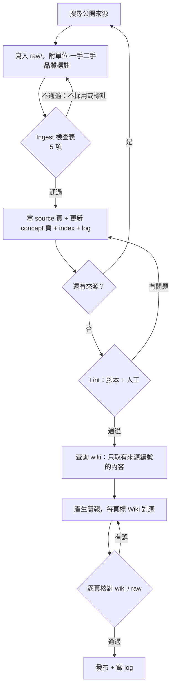

# 作業繳交：用 LLM Wiki 做教學 HTML 簡報

## 1. LLM Wiki 主題與簡短介紹
- **主題**：減脂與飲食
- **讀者**：有運動習慣、但飲食沒有系統的人
- **做法**：參考 Karpathy 的 LLM Wiki 模式，分三層：`raw/`（不可變的原始來源）、`wiki/`（LLM 維護的互相連結的 markdown）、`CLAUDE.md`（schema，規定格式與流程）。另有 `index.md`（內容目錄）與 `log.md`（時間序紀錄）。
- **規模**：7 篇來源（S1–S7）、7 個來源頁、8 個概念頁、index、log，共 17 頁 wiki。

## 2. LLM Wiki 成果
資料夾 `fatloss-wiki/`（隨本文一起交付的 zip）：
```
CLAUDE.md                  schema + Ingest 檢查表（第一次執行後新增）
raw/S1…S7                  7 篇來源（網址、取得日期、重點、限制、未採用的數字）
wiki/index.md              目錄＋已知資料缺口
wiki/log.md                ingest / lint / build 紀錄
wiki/sources/S1…S7         來源摘要頁
wiki/concepts/             熱量赤字、減重速度、蛋白質、適應性產熱與停滯期、
                           睡眠與減脂、間歇性斷食、飲食類型與遵從度、保留肌肉
tools/lint.py              lint 腳本（壞連結、孤兒頁、無來源編號的數字）
slides/fatloss-deck.html   簡報原始檔
```
7 篇來源：S1 ISSN 立場聲明、S2 蛋白質統合分析（Nunes 2022）、S3 蛋白質補充統合分析（BJSM 2018）、S4 Harvard Health 熱量赤字（CDC 建議為二手引述）、S5 適應性產熱系統性回顧、S6 睡眠與減脂隨機交叉試驗、S7 Cochrane 2026 間歇性斷食。

## 3. 教學 HTML 簡報
13 頁，教學結構：方法 → 5 個問題（赤字、速度、蛋白質、保肌、停滯/斷食）→ 案例（睡眠圖表）→ 迷思對照 → 總結與限制 → 來源。
**每頁底部有「Wiki 對應」**，標出該頁用到的 wiki 頁面與來源編號。簡報已發布為線上連結（見對話中的卡片）。

## 4. Loop / Graph 設計



**會重複執行的步驟**
- 搜尋 → 檢查 → 寫入：每篇來源跑一次（7 次）。
- Lint → 修正：簡報前一定跑；有問題回到寫入。
- 簡報 → 核對 → 重新生成：有錯就改該頁。

**需要檢查／重新生成的地方**
1. Ingest 檢查表（單位與情境、一手/二手、來源品質、內部一致性、樣本大小）。
2. Lint：腳本抓結構問題（壞連結、孤兒頁、無來源編號的數字），人工抓內容問題。
3. 簡報核對：關鍵數字回查 raw；每頁必須能對應到 wiki 頁面。

**為什麼這樣設計**
- 簡報只能從 wiki 取材，wiki 的每個數字都要有來源編號，所以簡報不會憑空出現沒出處的說法。
- 檢查點放在資訊「進入」wiki 的地方，而不只放在最後，因為錯誤一旦寫進 wiki 就會被多個頁面與簡報重複引用。

## 5. 一次實際執行的結果與檢查紀錄（摘自 `wiki/log.md`）
- Ingest：7 篇，新增 17 頁 wiki。
- Lint（`tools/lint.py`）：17 頁、壞連結 0；孤兒頁只有 index（正常）；4 條「含數字但無來源編號」的行，都是「這個數字不採用」的備註（誤報）。
- 人工檢查發現的 4 個內容問題（腳本抓不到）：
  1. 蛋白質單位混淆：S1 的 2.3–3.1 是 g/kg **去脂體重**（減脂）；S3 的 1.62 是 g/kg **體重**（增肌）。→ 概念頁分兩種情境。
  2. CDC 減重速度數字來自二手引述。→ 標註為二手。
  3. S7 與「不介入」比較的結果，文字說「差異很小」但信賴區間不含 0。→ 不引用。
  4. 商業部落格的適應性產熱數字（5–15%）。→ 不採用。
- 簡報核對：13 頁都有「Wiki 對應」；引用的概念頁都存在；關鍵數字都能在 raw/ 找到。
- 簡報修正 2 處：睡眠長條圖最高柱與數字標籤重疊（改比例尺）；第 4 頁一句是我自己的推論（改為 S1 的結論並標來源）。

## 6. 反思
**哪個節點最常出錯？** Ingest（從來源抽取數字與結論）。四個問題裡有三個（單位混淆、二手數字、來源自相矛盾）和一個來源品質問題都出在這裡，而且這類錯誤不會被「壞連結」之類的結構檢查抓到，只能在讀來源時發現。

**把檢查前移到哪裡？** 原本的想法是「簡報做完再查」。但蛋白質兩套數字如果到簡報階段才發現混淆，已經被寫進概念頁、保留肌肉整合頁和簡報。所以我把檢查前移到 Ingest：每篇來源寫進 raw/ 之前先過 5 項檢查表（單位與情境、一手/二手、來源品質、內部一致性、樣本大小），結果寫在 raw 檔裡。

**有修改 workflow 嗎？為什麼？** 有。(1) `CLAUDE.md` 新增「Ingest 檢查表」；(2) 概念頁固定加「爭議與限制」小節；(3) lint 分成腳本（結構）與人工（內容）兩層，因為腳本抓不到單位混淆。

**誠實的限制**
- 我的 schema 寫著 ingest 要「一篇一篇與使用者討論」。實際上「討論」只發生在開頭（選主題、讀者、資料來源、輸出形式），7 篇是我一次批次 ingest，並靠檢查表自我檢查。如果要更符合 Karpathy 的做法，下一步應該逐篇與你確認重點。
- 簡報的事實核對是我用腳本與人工回查 raw，不是由獨立的檢查者完成。
- S4 的 CDC 數字、S5 的細節仍是二手或摘要層級，已在簡報最後一頁的限制中說明。
